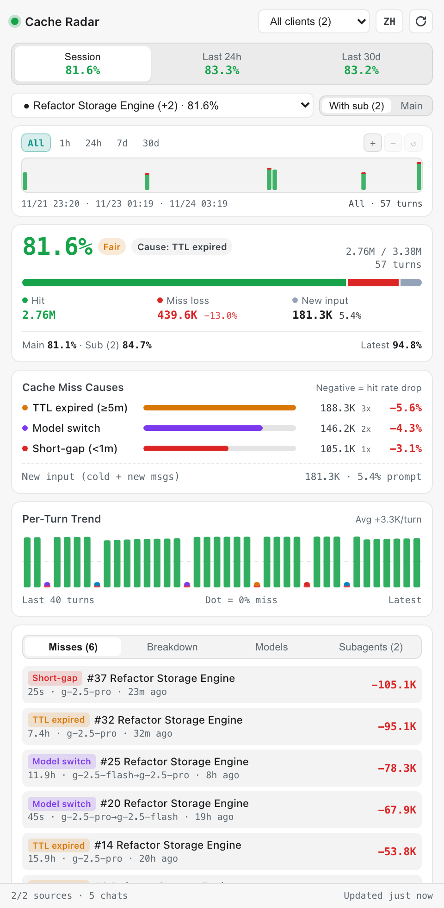
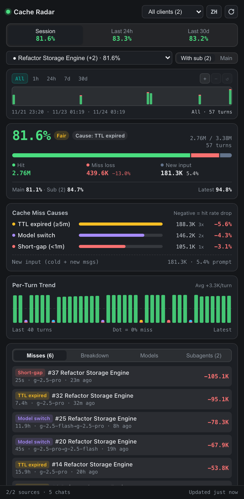
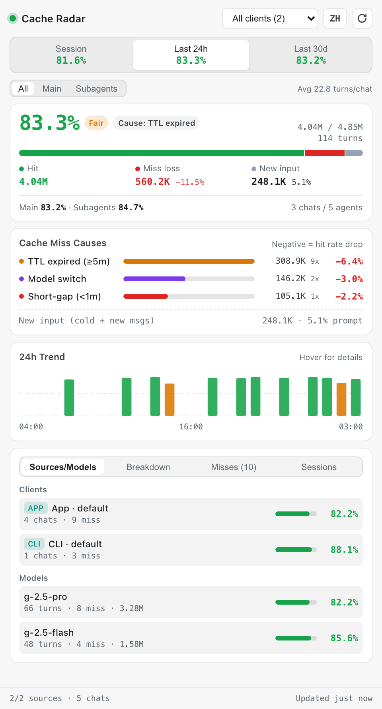

# Cache Radar (`agy-cache-radar`)

English | [简体中文](README.zh-CN.md)

A zero-dependency Antigravity (`agy`) side-panel plugin and CLI tool for inspecting prompt cache hit rates, diagnosing cache misses, and filtering multi-day sessions across all local Antigravity desktop profiles and CLI directories.

## Screenshots

<table>
  <tr>
    <td align="center" width="33%">
      
      <br />
      <sub><strong>Active Session (Light)</strong> — multi-day timeline scrubber, hit-rate breakdown, miss causes, and per-turn trend</sub>
    </td>
    <td align="center" width="33%">
      
      <br />
      <sub><strong>Active Session (Dark)</strong> — automatically synced with the Antigravity host theme</sub>
    </td>
    <td align="center" width="33%">
      
      <br />
      <sub><strong>Last 24 Hours</strong> — hourly trend, main vs. subagent split, and client/model breakdown</sub>
    </td>
  </tr>
</table>

## Features

- **3-Tab Side Panel Widget**:
  1. **Active Session** — Cumulative and latest-turn hit rate, zoomable multi-day timeline scrubber, cache-miss attribution with explicit `-X.X%` hit-rate impact, per-turn trend chart, subagent/swarm tree toggle (include subagents vs. main only), and drilldown tabs (miss events, interval/context distributions, models, and subagents).
  2. **Last 24 Hours** — Rolling 24-hour event-level hit rate, hourly bar chart, role filter (all, main only, subagents only), client/profile breakdown, model breakdown, and top sessions.
  3. **Last 30 Days** — Rolling 30-day event-level hit rate, daily trend chart, client/profile breakdown, model breakdown, and top sessions.
- **DevTools-Style Zoomable Timeline Scrubber**:
  - Plots session turns on a time-scaled 72-bin chronological activity track so idle overnight intervals appear as gaps while active bursts stand out by density and hit rate.
  - Supports drag-to-brush range selection, left/right handle resizing, dragging the selected window to pan, mouse-wheel and `+`/`−`/`↺` zoom controls, double-click reset, and `All` / `1h` / `24h` / `7d` / `30d` quick presets.
  - Recalculates every Active Session metric for the selected range while preserving pre-window turn transition history, so resumed turns after an idle gap are still attributed to idle TTL expiry rather than misclassified as cold starts.
- **Exact Subagent & Swarm Accounting**:
  - Reads isolated child transcripts and merges parent-child edges from `conversation_summaries.db`, `conversation_parents`, and `swarm/members.json`.
  - Handles multi-level subagent trees with cycle and orphan guards, deduplicates identical forked leading prefixes, and enforces `All = Main Only + Subagents/Swarm` on rolling windows.
- **Multi-Client & Multi-CLI Auto-Discovery**:
  - Automatically discovers Desktop profiles (`~/.agy-profiles/*`), standard App/IDE directories (`~/.gemini/antigravity`, `~/.gemini/antigravity-ide`), and CLI directories (`~/.gemini/antigravity-cli*`), deduplicating symlinks and conversation IDs while skipping backup directories by default.
- **Bilingual UI & CLI (`en` / `zh-CN`)**:
  - Side panel widget supports English and Simplified Chinese with an instant topbar language toggle (`EN`/`ZH`) that re-renders client-side with zero extra fetches.
  - Resolves locale by URL query parameter (`?lang=en` or `?lang=zh-CN`), `localStorage` (`cr_lang`) persistence, and automatic browser locale detection (`navigator.language`).
  - CLI reporter (`scripts/cache-stats.mjs`) supports `--lang <en|zh-CN>` and auto-detects locale from `LC_ALL` / `LANG`.
- **Zero Runtime Dependencies & Local-Only**:
  - Runs directly on Antigravity's bundled Node.js (`>=22.5.0`, using built-in `node:sqlite`), opens local databases read-only, tails JSONL transcripts incrementally by byte offset, and uses conditional ETag polling.

## Installation

Validate and install the plugin from a local clone:

```bash
git clone https://github.com/meomeo-dev/agy-cache-radar.git
cd agy-cache-radar
agy plugin validate .
agy plugin install .
```

In the Antigravity desktop app, open **Plugins > Cache Radar** or launch the widget from the side panel **`+`** menu (right-click the tab to **Pin Tab**).

> **Note on plugin updates**: Antigravity keeps the sidecar Node process and closed side-panel iframes cached in memory. After syncing updated code into `~/.gemini/config/plugins/cache-radar`, toggle **Cache Radar** off and back on in the Plugins Manager to reload the process and assets.

## Standalone Preview & CLI Usage

### Local Browser Preview

```bash
npm run dev
# Serves http://127.0.0.1:4318/ against your local Antigravity data directories.
# Optional query params: ?tab=session|24h|30d&theme=light|dark&source=all|current&lang=en|zh-CN
```

### Terminal Reporter

```bash
npm run stats
node scripts/cache-stats.mjs --last 24h
node scripts/cache-stats.mjs --from 2026-11-23T00:00:00Z --to 2026-11-23T23:59:59Z
node scripts/cache-stats.mjs --source current
node scripts/cache-stats.mjs --lang en
node scripts/cache-stats.mjs --lang zh-CN
node scripts/cache-stats.mjs --json
```

## Custom Data Directories (Optional)

Create `~/.gemini/config/cache-radar.json`:

```json
{
  "extraDataDirs": ["/path/to/another/antigravity-data"],
  "extraProfileRoots": ["~/custom-agy-profiles"],
  "excludePatterns": ["test-profile"],
  "includeBackups": false
}
```

Or configure via environment variables:

- `AGY_CACHE_DATA_DIRS`: colon-separated extra Antigravity data directories.
- `AGY_CACHE_EXTRA_PROFILES_DIRS`: colon-separated profile roots.
- `AGY_CACHE_INCLUDE_BACKUPS=1`: include `*-backup` directories.

## Project Layout

```text
agy-cache-radar/
├── plugin.json                     # Antigravity plugin manifest
├── README.md                       # English documentation
├── README.zh-CN.md                 # Simplified Chinese documentation
├── AGENTS.md                       # Repository engineering guidelines
├── CHANGELOG.md                    # Release history
├── handoff.md                      # Project handoff notes and open tasks
├── assets/logo.svg                 # 128x128 plugin icon
├── docs/
│   ├── architecture.md             # Data model, DAG dedup, and discovery spec
│   └── screenshots/                # Bilingual widget screenshots (EN & ZH-CN, light/dark/24h)
├── src/
│   ├── constants.mjs               # Time windows, regexes, limits
│   ├── discovery.mjs               # Multi-client / multi-CLI data directory discovery
│   ├── metadata.mjs                # Read-only SQLite + swarm members + presence reader
│   ├── transcript.mjs              # Incremental byte-offset JSONL reader
│   ├── hierarchy.mjs               # Conversation DAG + fork-prefix deduplication
│   ├── metrics_core.mjs            # Shared accumulator and hit-rate helpers
│   ├── diagnostics.mjs             # Cache-miss reason classification and matrices
│   ├── session_metrics.mjs         # Active session tree metrics & time-range slicing
│   ├── window_metrics.mjs          # 24h & 30d event-window aggregation
│   ├── aggregator.mjs              # Full snapshot composer
│   └── index.mjs                   # CacheRadarEngine facade + ETag builder
├── sidecars/cache_radar/
│   ├── sidecar.json                # AUX_PANE UI sidecar manifest
│   ├── main.mjs                    # SidecarApp + standalone HTTP server
│   └── web/                        # 3-tab widget assets (classic IIFE scripts)
│       ├── i18n.js                 # en / zh-CN dictionary, locale detection, and switcher
│       └── ...                     # index.html, styles.css, app.js, views.js, diag_views.js, timeline*.js, charts.js, format.js
├── scripts/cache-stats.mjs         # Terminal / skill CLI reporter (--lang en|zh-CN)
├── skills/cache-radar/SKILL.md     # /cache-radar skill definition
└── tests/                          # Automated tests (node --test)
    ├── i18n.test.mjs               # Dictionary parity, VM render, switcher, and CLI i18n tests
    └── ...                         # aggregator, diagnostics, discovery, hierarchy, server tests
```

## Development & Testing

```bash
npm test
npm run validate
```

See [docs/architecture.md](docs/architecture.md) for the complete formula, deduplication, and multi-client discovery specification.

## License

[MIT](LICENSE)
