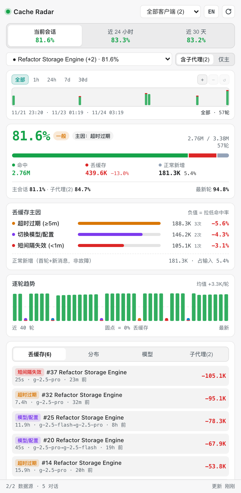
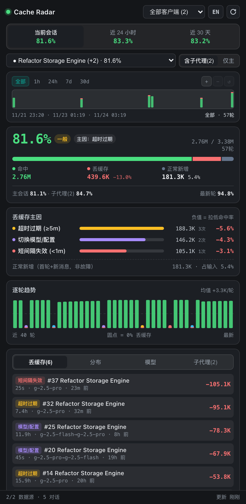
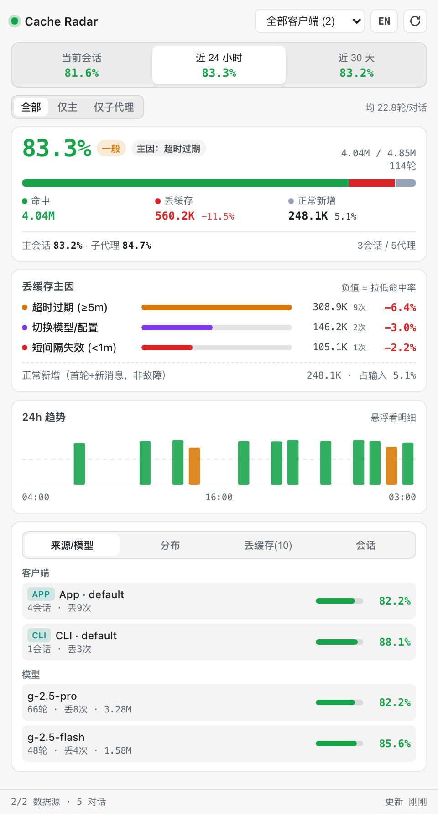

# Cache Radar (`agy-cache-radar`)

[English](README.md) | 简体中文

一个零运行时依赖的 Antigravity（`agy`）侧边栏插件与命令行工具，用于查看本机所有桌面端 Profile 与 CLI 数据目录的提示词缓存命中率、排查丢缓存原因，并按时间范围筛选跨天长会话。

## 界面预览

<table>
  <tr>
    <td align="center" width="33%">
      
      <br />
      <sub><strong>当前会话（浅色）</strong>：跨天活跃时间轴、命中构成、丢缓存主因与逐轮趋势</sub>
    </td>
    <td align="center" width="33%">
      
      <br />
      <sub><strong>当前会话（深色）</strong>：自动跟随 Antigravity 宿主主题切换</sub>
    </td>
    <td align="center" width="33%">
      
      <br />
      <sub><strong>近 24 小时</strong>：分小时趋势、主会话与子代理拆分、客户端与模型分布</sub>
    </td>
  </tr>
</table>

## 核心功能

- **三标签页侧边栏面板**：
  1. **当前会话**：展示累计与最新一轮命中率、可缩放多天时间轴、丢缓存主因及对总命中率的 `-X.X%` 影响幅度、逐轮命中率柱状图、子代理与 Swarm 汇总开关（`含子代理` / `仅主`），以及 `丢缓存` / `分布` / `模型` / `子代理` 四个下钻视图。
  2. **近 24 小时**：按单轮事件时间戳统计过去 24 小时命中率，提供分小时柱状图、角色筛选（`全部` / `仅主` / `仅子代理`）、客户端与模型分布，以及按命中率排列的会话列表。
  3. **近 30 天**：按本地自然日统计过去 30 天趋势，同样支持角色筛选、多客户端聚合、模型分布与会话下钻。
- **Chrome DevTools 风格可缩放时间轴**：
  - 按真实时间跨度将整场会话映射到 72 个时间槽，空闲与隔夜时段留空，活跃时段以柱高反映调用密度、以颜色区分命中率。
  - 支持直接拖拽框选时段、拖左右边缘调范围、拖选区平移、滚轮与 `+` / `−` / `↺` 缩放、双击重置，以及 `全部` / `1h` / `24h` / `7d` / `30d` 快捷预设。
  - 筛选时段后，当前会话内的所有卡片指标都会按该时段重算，同时保留窗口之前的轮次衔接历史，避免跨天续聊的第一轮被误判为首轮冷启动。
- **准确统计子代理与 Swarm（不漏算、不重复统计）**：
  - 读取每个子代理与 Swarm Worker 的独立对话日志，合并 `conversation_summaries.db`、`conversation_parents` 与 `swarm/members.json` 中的父子关系。
  - 支持多级嵌套子树、环路与孤儿节点保护、fork 继承前缀步骤去重，并在 24 小时与 30 天窗口中保证「全部 = 仅主 + 仅子代理」。
- **多客户端与多 CLI 目录自动发现**：
  - 自动发现桌面端多 Profile（`~/.agy-profiles/*`）、默认桌面端与 IDE 目录（`~/.gemini/antigravity`、`~/.gemini/antigravity-ide`）以及多个 CLI 目录（`~/.gemini/antigravity-cli*`），对符号链接和跨目录重复对话做去重，并默认跳过备份目录。
- **中英双语界面与命令行（`en` / `zh-CN`）**：
  - 侧边栏面板完整支持简体中文与英文，顶部操作区提供 `EN`/`ZH` 一键语言切换按钮，纯前端即时重绘且不触发额外请求。
  - 语言解析按 URL 查询参数（`?lang=zh-CN` 或 `?lang=en`）、`localStorage`（`cr_lang`）持久化与浏览器语言（`navigator.language`）自动检测的优先级生效。
  - 终端脚本（`scripts/cache-stats.mjs`）支持 `--lang <en|zh-CN>` 参数，默认根据 `LC_ALL` / `LANG` 自动匹配语言。
- **零外部依赖、纯本地只读**：
  - 直接运行在 Antigravity 内置 Node.js（`>=22.5.0`，使用内置 `node:sqlite`）上，只读访问本地数据库，按字节偏移量增量读取 JSONL 日志，前端通过 ETag 条件轮询减少无效重绘。

## 安装方式

克隆仓库后校验并安装到 Antigravity：

```bash
git clone https://github.com/meomeo-dev/agy-cache-radar.git
cd agy-cache-radar
agy plugin validate .
agy plugin install .
```

安装完成后，在 Antigravity 桌面端打开 **Plugins > Cache Radar**，或从右侧边栏 **`+`** 菜单打开面板（右键标签页可选择固定标签）。

> **更新插件提示**：Antigravity 会在内存中驻留已启动的 sidecar 进程并缓存关闭后的面板 iframe。将新版代码同步到 `~/.gemini/config/plugins/cache-radar` 后，需在插件管理器中将 **Cache Radar** 关闭再重新开启一次以重载进程和前端资源。

## 本地预览与命令行用法

### 独立浏览器预览

```bash
npm run dev
# 启动 http://127.0.0.1:4318/ 读取本机 Antigravity 数据目录
# 可选查询参数：?tab=session|24h|30d&theme=light|dark&source=all|current&lang=en|zh-CN
```

### 终端统计脚本

```bash
npm run stats
node scripts/cache-stats.mjs --last 24h
node scripts/cache-stats.mjs --from 2026-11-23T00:00:00Z --to 2026-11-23T23:59:59Z
node scripts/cache-stats.mjs --source current
node scripts/cache-stats.mjs --lang zh-CN
node scripts/cache-stats.mjs --lang en
node scripts/cache-stats.mjs --json
```

## 自定义数据目录（可选）

如需补充额外目录或排除特定 Profile，可创建 `~/.gemini/config/cache-radar.json`：

```json
{
  "extraDataDirs": ["/path/to/another/antigravity-data"],
  "extraProfileRoots": ["~/custom-agy-profiles"],
  "excludePatterns": ["test-profile"],
  "includeBackups": false
}
```

也支持通过环境变量配置：

- `AGY_CACHE_DATA_DIRS`：以冒号分隔的额外 Antigravity 数据目录。
- `AGY_CACHE_EXTRA_PROFILES_DIRS`：以冒号分隔的额外 Profile 根目录。
- `AGY_CACHE_INCLUDE_BACKUPS=1`：设为 `1` 时纳入 `*-backup` 备份目录。

## 目录结构

```text
agy-cache-radar/
├── plugin.json                     # Antigravity 插件清单
├── README.md                       # 英文文档
├── README.zh-CN.md                 # 简体中文文档
├── AGENTS.md                       # 仓库开发与规范说明
├── CHANGELOG.md                    # 版本变更记录
├── handoff.md                      # 项目交接记录与待办事项
├── assets/logo.svg                 # 128x128 插件图标
├── docs/
│   ├── architecture.md             # 数据模型、去重规则与目录发现说明
│   └── screenshots/                # 中英双语界面截图（浅色、深色、近 24 小时）
├── src/
│   ├── constants.mjs               # 时间窗口、正则与常量定义
│   ├── discovery.mjs               # 多客户端与多 CLI 数据目录自动发现
│   ├── metadata.mjs                # 只读 SQLite、Swarm 成员与活跃状态读取
│   ├── transcript.mjs              # 按字节偏移量增量读取 JSONL 日志
│   ├── hierarchy.mjs               # 对话 DAG 构建与 fork 前缀去重
│   ├── metrics_core.mjs            # 公共累加器与命中率计算函数
│   ├── diagnostics.mjs             # 丢缓存原因分类与分组统计矩阵
│   ├── session_metrics.mjs         # 当前会话子树聚合与时间范围切片
│   ├── window_metrics.mjs          # 近 24 小时与近 30 天事件窗口聚合
│   ├── aggregator.mjs              # 全量快照拼装
│   └── index.mjs                   # CacheRadarEngine 入口与 ETag 计算
├── sidecars/cache_radar/
│   ├── sidecar.json                # AUX_PANE 侧边栏 sidecar 清单
│   ├── main.mjs                    # SidecarApp 入口与独立 HTTP 预览服务
│   └── web/                        # 三标签页前端资源（经典 IIFE 脚本）
│       ├── i18n.js                 # 中英双语词典、语言解析与切换逻辑
│       └── ...                     # index.html、styles.css、app.js、views.js、diag_views.js、timeline*.js、charts.js、format.js
├── scripts/cache-stats.mjs         # 终端与 Skill 统计脚本（支持 --lang en|zh-CN）
├── skills/cache-radar/SKILL.md     # /cache-radar Skill 定义
└── tests/                          # 自动化测试（node --test）
    ├── i18n.test.mjs               # 双语词典校验、VM 渲染、语言切换与 CLI 测试
    └── ...                         # aggregator、diagnostics、discovery、hierarchy、server 测试
```

## 开发与测试

```bash
npm test
npm run validate
```

详细计算公式、父子去重规则与目录发现逻辑见 [docs/architecture.md](docs/architecture.md)。

## 许可证

[MIT](LICENSE)
